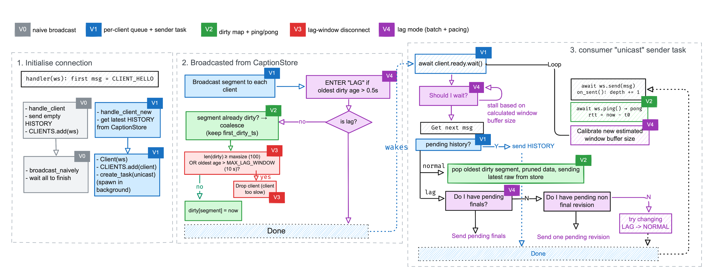

<!-- 

 pandoc REPORT.md -o report.pdf

The report must include: architecture and protocol; revision/recovery semantics; backpressure/overload policy;public experiments; at least one before/after optimization comparison; P50/P95/P99/freshness/final-completeness results; discussion of failures and trade-offs; limitations; and a short future-work/FYP direction.

-->
# Architecture and Protocol

Our project splits into two parts: the solution server and the client. The solution server has two main components: a `CaptionStore`, which holds the captions received from the caption server, and a list of `Client` objects, each holding a client's websocket connection and its send queue.

Upon receiving the websocket initialized message, our server uses the message `type` to detect whether it is a request from the caption server or client (`SOURCE_HELLO` or `CLIENT_HELLO`). Then, our server has two separate handlers (`handle_source` and `handle_client_new`) to handle the websocket. The following sections will explain how each handler is implemented internally.

## Server: storing captions
We utilize a `CaptionStore` object (`server/store.py`) holding the server's view of the transcript within `keep_seconds` seconds range. To achieve this, we maintain a deque of segment numbers `order` to hold the transcript within `keep_seconds` seconds and a hashmap from segment number to the `Entry` which holds the information of the segment, including `source_ts` (source timestamp) and the text.

::: {#fig:caption-store}
{width=60%}
:::

When our backend receives a `CAPTION_UPDATE` message from the caption server, we parse and validate it into an `Entry` (malformed messages are counted and dropped), then call `store.apply(entry)`, which returns either `STALE`, `DUP_FINAL`,`TOO_OLD`, or `ACCEPTED` based on our **revision semantics**.

- A revision is only accepted if it is strictly newer than the one we hold (`new.revision > cur.revision`); older or repeated revisions are `STALE` and dropped, so a delayed packet can never roll a caption back. 
- Any update for a segment that is *already-final*[^1] returns `DUP_FINAL`.
- Any update for a segment older than the oldest one on the deque (i.e., already pruned) is considered `TOO_OLD`. A new segment is simply appended (and the deque is re-sorted in the rare case it arrives out of order).
- Otherwise, we treat it as `ACCEPTED`.

For all `ACCEPTED` requests, we update the store and broadcast the captions to clients. It is very important to keep the store up-to-date (and atomic) because a client that reconnects (and sends a `HISTORY` request) will ask for the segments it lacks (via `get_history()`). While updating the store, we also prune the outdated segments (segment whose `source_ts` is older than `latest_ts - keep_seconds`, where `latest_ts` is the newest source timestamp seen) to bound the size of our deque. We use `keep_seconds = 120` and additionally cap the deque at `max_items = 500` entries in case timestamps misbehave.

[^1]: Checking *already-final* is tricky: since pruning removes segments from memory, we cannot simply look a segment up to know if it was finalized. We therefore keep `contig_final`, the highest $N$ such that segments $1..N$ are all final. As such, a late update for a segment at or below `contig_final` is rejected as `DUP_FINAL`.

### Recovery semantics

On reconnect (or late join, with `last_segment = 0`), the client sends `CLIENT_HELLO` with its resume state (`last_segment`, `last_revision`, `history_seconds`). `get_history()` returns, in order, the finalized segments it lacks within the last `history_seconds` (clamped to $[0, 60]$; invalid fields fall back to defaults). This `HISTORY` is queued before the client joins the broadcast set, so it precedes live updates; any overlap is deduplicated by the client's revision rule.

## Server: Sending to clients

When our backend receives a `CLIENT_HELLO` message from the client to initiate a connection, the server calls `CaptionStore.get_history()`, queues the result as the client's initial `HISTORY`, adds the `Client` to the `CLIENTS` set and the server spawns an asynchronous task, `asyncio.create_task(unicast(client))`, to be handled in the background.

**The naive implementation (V0, `broadcast_naively`)** sends every accepted update directly to every client from inside the source handler and awaits all of the sends. This is simple and preserves ordering, but the source handler cannot move on until the *slowest* client has accepted the frame. A single slow reader therefore delays both the store update and delivery to every other client.

The natural fix is to decouple receiving from sending, in a producer-consumer style. As shown in Figure 2, instead of waiting on each send, the server places updates on per-client queues and lets a separate task per client drain them. This is our **V1 implementation**.

### V1 - Decoupling

When an update is accepted, the server does not wait for any client. It simply notes that each client has something new to send and wakes that client's sender task, so the server can go straight back to reading from the source. Each sender task then delivers the client's history first, followed by the pending updates in order, skipping anything the client no longer needs. Because the text is looked up at the moment of sending, the client always receives the latest version of each caption.

### V2 - Backpressure

In V1, a slow client's backlog still grows with every revision, and the server has no idea how fast the client is reading. V2 keeps only the latest pending change per caption segment, so repeated edits to the same segment collapse into one, and the backlog is limited by the number of segments rather than the number of edits. After each send, the server also waits for a quick round-trip check from the client; this confirms the client has caught up, and a growing round-trip time is the signal used by later versions to detect a slow client.

### V3 - Lag-window disconnect

If a client falls more than 10 s behind, or its backlog reaches 100 segments, the server disconnects it as "too slow". This stops a hopeless client from holding server memory and receiving stale captions; it can reconnect and catch up through history (see Recovery semantics).

### V4 - Lag mode

Rather than only disconnecting slow clients, V4 lets them switch into a catch-up mode. A client normally receives every revision in order, but once it falls about half a second behind, or repeatedly responds slowly, the server stops sending each intermediate edit. Instead, it sends all the finished captions the client is missing in a single message, followed by only the most recent in-progress caption. The server also learns roughly how fast each lagging client reads and how much it can absorb at once, and waits until the client should have caught up before sending more, so every message is as fresh as possible. The client returns to normal mode only once it has been consistently fast for a short while, which avoids switching back and forth.

## Client (`app.js`)

The browser client opens a WebSocket, sends `CLIENT_HELLO`, and renders every `CAPTION_UPDATE` and `HISTORY` item through one `append()` path in `FrontEndRenderer`, which maps each segment to a DOM row holding its `revision_id`, `source_ts` and `is_final`. A message updates its row only if `msg.revision > row.revision_id`, replacing the text in place so each segment appears once with its latest text; `is_final` is sticky, and rows are re-sorted by segment when updates arrive out of order. Since `HISTORY` items pass through the same check, overlap with live updates is deduplicated for free. The client keeps finals for `KEEP_MESSAGE_WINDOW = 90` s (above the required 60 s), pruning once a second, while the 15/30/60 s recall view only hides rows, so switching windows needs no server request. On close, the client reconnects with `last_segment`, `last_revision` and `history_seconds = 60` under a stable `client_id` from `sessionStorage`, so a client dropped by V3 (close code 1013) recovers its missing finals through `HISTORY`; only a 1008 close (protocol violation, e.g. an invalid hello) is shown to the user instead of triggering a reconnect.

# Results

# Discussion

# Conclusion

\appendix

# Raw data

# ASR Bonus: Real-Lecture Caption Source

## Integration

The ASR path is a third, optional component: `bonus_asr/asr_source.py` replaces `caption_source.py` as the caption source. It connects to the same `solution_server.py` over WebSocket, sends `SOURCE_HELLO`, then `CAPTION_UPDATE` messages, and finally `SOURCE_DONE`. **Neither `solution_server.py` nor the browser client was modified**; the server cannot tell the ASR source from the deterministic source, so every mechanism described in the main report (revision semantics, history, backpressure, lag mode, recovery) applies unchanged to ASR captions.

### Pipeline

1) `ffmpeg` (lecture audio / mic (default), 16 kHz mono s16le) 
2) reader thread (1 s chunks, bounded queue (of size 30 chunks)) 
3) faster-whisper `base.en` (CPU, int8, 4 threads, VAD filter) 
4) `CAPTION_UPDATE` 
5) `solution_server.py` 
6) browser client.

| Protocol field | How the ASR source sets it |
|---|---|
| `segment` | One segment per fixed 5 s window of audio (`SEGMENT_TIMING_SEC = 5`); incremented only if the window produced text, so silent windows do not create empty segments. |
| `revision` | Each new 1 s chunk re-transcribes the whole window buffered so far and sends the result as the next revision. The first revision waits for 2 s of audio (`FIRST_REVISION_SEC = 2`), giving up to 3 provisional revisions and 1 final per segment. |
| `final` | `true` once the window reaches 5 s, and for the partial window flushed on shutdown. |
| `text` | The full transcript of the window, not a delta, so the client's replace-by-revision rule shows the newest hypothesis even when Whisper rewrites earlier words. |
| `source_ts` | Wall-clock time at which the newest audio chunk was read. |

### How to run it

Installing the required dependencies:

    sudo apt install ffmpeg
    python3 -m venv asr-venv 
    asr-venv/bin/pip install -r bonus_asr/requirements-asr.txt

Running it (from the repository root, one terminal each and in the same order):

    venv/bin/python solution_server.py --port 8765
    python3 -m http.server 8000 -d client
    asr-venv/bin/python bonus_asr/asr_source.py
  
  - Note the first run will download the `base.en` model (Around 150 MB)

## Limitations

- **Fixed-time segmentation.** Windows end every 5 s regardless of speech, so sentences and occasionally words are split across segments, and each window is transcribed without the previous one as context, which lowers accuracy at boundaries. Pause-based segmentation (using the VAD) would align segments with sentences.
- **Re-transcription cost.** Each revision re-transcribes the whole window (2–5 s of audio), so the work per window grows with each revision. If the transcription timing exceeds the 1 s chunk interval, audio queues up.
- **Overload drops audio to bound delay.** The audio queue is bounded at 30 chunks (30 s). When transcription falls behind, the oldest queued chunk is dropped and logged, so caption delay is capped at roughly 30 s instead of growing without limit, at the cost of permanently lost words. The dropped chunk can also leave a gap inside a window.
- **No source reconnect or session reset.** Segment numbers restart at 1 on every run, while the server rejects updates for segments it already holds as final (DUP_FINAL) and an open browser ignores revisions lower than the ones it already shows, so the server must be restarted and the browser reloaded before each ASR run. The ASR source also does not reconnect if the server connection drops; it must be started again.
- **Clock assumption.** `source_ts` uses the source machine's clock, and the client's recall window compares it with the browser's clock. This holds when both run on the same machine.
- **Accuracy not tuned.** `base.en` on CPU was chosen for real-time speed. Accuracy and model size are not graded and were not optimised.
    