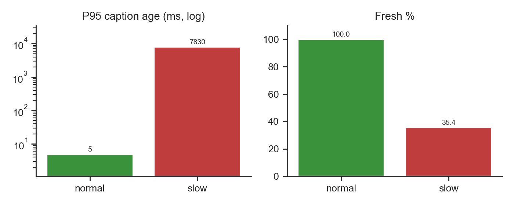
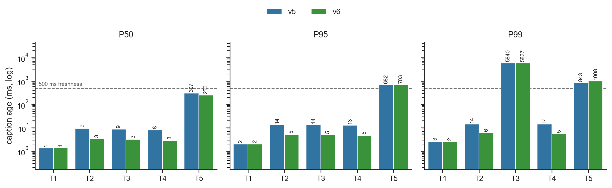

<!-- 

 pandoc REPORT.md -o report.pdf  --pdf-engine=xelatex

The report must include: architecture and protocol; revision/recovery semantics; backpressure/overload policy;public experiments; at least one before/after optimization comparison; P50/P95/P99/freshness/final-completeness results; discussion of failures and trade-offs; limitations; and a short future-work/FYP direction.

-->

# Architecture and Protocol

Our system has two parts: the solution server (`solution_server.py`) and the browser client (`client/app.js`). The server has two main components: a `CaptionStore`, which holds the captions received from the caption source, and a set of `Client` objects, each holding one client's WebSocket connection and its send queue.

When a WebSocket connects, the server reads the `type` of its first message to tell the caption source (`SOURCE_HELLO`) from a viewer (`CLIENT_HELLO`) and dispatches it to the matching handler (`handle_source` or `handle_client`). The following sections describe how each handler works internally.

## Server: storing captions
The `CaptionStore` (`server/store.py`) holds the server's view of the last `keep_seconds` of the transcript. It keeps a deque `order` of segment numbers, in order, and a hashmap from segment number to an `Entry` holding the segment's `source_ts` (source timestamp), revision, finality and text.

When our backend receives a `CAPTION_UPDATE` message from the caption server, we parse and validate it into an `Entry` (malformed messages are counted and dropped), then call `store.apply(entry)`, which returns `STALE`, `DUP_FINAL`, `TOO_OLD` or `ACCEPTED` based on our **revision semantics**.

| Result | Condition | Action |
|---|---|---|
| `STALE` | Segment held and `new.revision <= cur.revision` | Drop; a delayed packet never rolls a caption back |
| `DUP_FINAL` | Segment is *already-final*[^1] (held as final, or at/below `contig_final`) | Drop; a final is never replaced |
| `TOO_OLD` | Segment older than the oldest one on the deque (already pruned) | Drop |
| `ACCEPTED` | Otherwise (new segments are appended; the deque is re-sorted in the rare out-of-order case) | Replace entry, prune, broadcast |

For every `ACCEPTED` update, we update the store and then broadcast. Keeping the store current and consistent matters because a reconnecting client asks for the segments it lacks, which are served from the store by `get_history()`. While updating, we also prune outdated segments (those whose `source_ts` is older than `latest_ts - keep_seconds`, where `latest_ts` is the newest source timestamp seen) to bound the size of our deque. We use `keep_seconds = 120` and additionally cap the deque at `max_items = 500` entries in case timestamps misbehave.

After an update is accepted, `broadcast(segment)` (`solution_server.py`) hands only the *segment number* (not the text) to every connected client and returns immediately, without waiting for any network send. Each client's background sender then reads the latest text from the store when it is ready to send. How each client queues and paces these updates is described in [the next section](#server-sending-to-clients).

[^1]: Checking *already-final* is tricky: since pruning removes segments from memory, we cannot simply look a segment up to know if it was finalized. We therefore keep `contig_final`, the highest $N$ such that segments $1..N$ are all final. As such, a late update for a segment at or below `contig_final` is rejected as `DUP_FINAL`.

### Recovery semantics

On reconnect (or late join, with `last_segment = 0`), the client sends `CLIENT_HELLO` with its resume state (`last_segment`, `last_revision`, `history_seconds`). `get_history()` returns, in order, the finalized segments it lacks within the last `history_seconds` (clamped to $[0, 60]$; invalid fields fall back to defaults). This `HISTORY` is queued before the client joins the broadcast set, so it precedes live updates; any overlap is deduplicated by the client's revision rule.

## Server: Sending to clients

When a client connects (`CLIENT_HELLO`), the server queues its initial history from the store (see [Recovery semantics](#recovery-semantics)) and spawns a background sender task, `unicast(client)`. This task takes segment ids from the client's queue, reads their latest text from the store and sends them according to our protocol, which went through several versions during optimization. The table below summarizes how the sending path evolved from \vzero{} to \vsix{}; each version retains all previous functionality. The submitted `solution_server.py` is \vsix{}.

[^2]: Dirty set is a dictionary that maps segment id to the time it first became dirty. A segment is dirty for a client when its content has changed in the server's store but that client hasn't been sent the new version yet. Each client has its own dirty set.

```{=latex}
\begingroup\renewcommand{\arraystretch}{1.8}
```

| Mechanism | What it does | Problem addressed |
|---|------|------|
| \vzero{} Naive broadcast | Sends each update to every client; the source awaits all sends. | One slow client stalls the source and all others. |
| \vone{} Per-client dirty set[^2] | Each client has a FIFO queue of segment ids. `broadcast()` appends the segment id to the back of each client's queue (if already queued, it keeps its place, so repeated edits coalesce into one entry) and wakes that client's sender. The sender pops from the front and reads the segment's latest text from the store at send time. Close the client if its queue reaches 100 segments. | Backlog bounded by segments, not edits; slow readers block no one. *Issue:* `send()` returns once data is in the OS socket buffer, so the queue drains instantly and stays near zero; the real backlog hides in socket/client buffers, invisible to the server. |
| \vtwo{} Ping flow control | Ping after each send; wait for pong up to `PONG_WAIT` = 1 s. This ensures that the client has read every earlier message off the socket. | It solves the queue draining problem. We also use pong RTT for further optimizations (e.g., detecting client read rates). |
| \vthree{} Lag-window disconnect | Forcing client to disconnect when the oldest dirty entry is greater than  `MAX_LAG_WINDOW` = 10 s.| Bounds staleness; client recovers via `HISTORY`. |
| \vfour{} Lag mode (for slow clients) | Enter this mode if dirty age > 0.5 s or a pong > 0.3 s. Under lag mode, we send the missing finals oldest first. We only send the newest provisional messages after `LAG_PROV_GAP` = 4 s idle. Exiting lag mode requires 3 fast pongs and a 3-second minimum duration. | For slow clients, finals never delayed; unreadable intermediate revisions skipped. *Issue:* fast pongs only show the client is reading quickly *now*, not that it has caught up; it can leave lag mode with stale messages still in its receive buffer, fall behind again and oscillate between modes. |
| \vfive{} **Buffer-aware lag exit** | Fast pongs are no longer enough to exit: the server also estimates whether the client's receive buffer has drained (estimated reads > messages sent in lag + 36; see [Receive buffer estimation](#receive-buffer-estimation)). Soft-pong threshold lowered to 0.2 s. | Fixes the \vfour{} issue: no premature return to full updates, so no oscillation; also earlier lag detection. *Issue:* the lag-mode sender polls every 0.1 s and waits for a pong after every message, so a new final can sit for up to one poll interval plus a full RTT, and on a high-latency link throughput is capped at one message per RTT. |
| \vsix{} Event-driven pacing | Lag-mode sender sleeps on an event (woken by `broadcast()`) instead of polling every 0.1 s; a final that arrives while a pong is outstanding is sent at once; in lag mode it pings once every 2 messages (`PING_EVERY_N` = 2) rather than after each one. | Fixes the \vfive{} issue: new finals go out as soon as they arrive instead of waiting for the next poll, and halving the pings roughly doubles lag-mode throughput on a high-latency link. |

```{=latex}
\endgroup
```

### Receive buffer estimation

The server cannot see a client's receive buffer, i.e. the messages the client's WebSocket library has received but the client has not yet processed. A fast pong shows the client is reading quickly *now*, not that the buffer is empty, so from \vfive{} onwards the server estimates the backlog conservatively before letting a client leave lag mode:

1. **Assume the buffer was full when lag began.** `LAG_QUEUE_GUESS` = 32 messages, a deliberately high guess.
2. **Estimate the per-message read time** `iv_est` from pong RTTs during lag. While the buffer is full, each pong returns about one read interval after the previous one. We keep the largest value seen (capped at `IV_CAP` = 1 s), since overestimating is the safe direction. The initial estimate is the RTT of the pong that triggered lag mode (at least 0.1 s).
3. **Count reads.** Estimated reads = time in lag / `iv_est`. The client must work through the 32 assumed messages plus every message sent during lag (`lag_sent`).
4. **Exit only once it has caught up:** `reads - lag_sent >= LAG_QUEUE_GUESS + LAG_EXIT_MARGIN` (32 + 2), and the latest pong was fast (`LAG_CALM_PONGS` = 1, RTT $\le$ 0.2 s). On exit, every in-progress (non-final) segment is marked dirty again so the client immediately receives their latest text.

For example, a client reading one message every 0.5 s that has been sent 10 messages in lag needs about 44 reads (~22 s) before it may exit. Overestimating the buffer only delays the exit slightly, while underestimating would send the client back into lag almost immediately. (\vfive{} originally used a margin of 4, `IV_CAP` = 2 s and 3 fast pongs; we relaxed these so clients leave lag mode sooner once they recover.)

Putting the pieces together, each client's sender is a small two-state machine, in normal mode (every update, one pong per message) or lag mode (finals first, rationed provisionals). The transitions between the two states are the core of our backpressure policy and are summarised below.

\bwarn

**Normal  &rarr; Lag.** The server switches a client to lag mode as soon as it looks like the client cannot keep up: its oldest unsent update is older than 0.5 s (`LAG_AGE_ENTER`), or a single pong takes longer than 0.2 s (`LAG_PONG_SOFT`) or times out after 1 s. Its dirty set is cleared (the store and the client's final cursor now determine what to send), and from then on it sends only what matters: missing finals oldest first, never paced, plus the latest provisional after 4 s without a send.

**Lag &rarr; Normal.** The client returns to normal mode once its latest pong is fast again *and* the receive-buffer estimate says its backlog has drained. Its in-progress segments are then re-queued so it receives full updates again.

\ewarn

### Addressing the two advanced challenges

**Challenge 1: Slow-reader semantic backpressure.** Each client's backlog is bounded by its dirty set (at most 100 segments) and the 10 s lag window (\vone{}, \vthree{}), so it does not grow with the edit rate. Since repeated edits to a segment coalesce into one entry, superseded provisionals are never queued, and in lag mode only the newest provisional is sent (\vfour{}). Because `broadcast()` never waits and every client has its own sender task, a slow reader cannot delay the source or other clients. Finals are still sent oldest first in lag mode, and a client that gets cut off recovers them through `HISTORY`.

**Challenge 2: Constrained-bandwidth semantic delivery.** We use ping/pong flow control (\vtwo{}) to detect the bottleneck: when the link is congested, pongs come back slowly, which puts the client into lag mode (\vfour{}, \vfive{}). The remaining bandwidth then goes to missing finals first, then the latest provisional, while intermediate revisions are skipped instead of building a stale backlog. Once pongs are fast again and the client's queue has drained, it returns to normal mode and receives full updates again.

## Client (`app.js`)

The browser client opens a WebSocket, sends `CLIENT_HELLO`, and renders every `CAPTION_UPDATE` and `HISTORY` item through one `append()` path in `FrontEndRenderer`, which maps each segment to a DOM row holding its `revision_id`, `source_ts` and `is_final`. A message updates its row only if `msg.revision > row.revision_id`, replacing the text in place so each segment appears once with its latest text; `is_final` is sticky, and rows are re-sorted by segment when updates arrive out of order. Since `HISTORY` items pass through the same check, overlap with live updates is deduplicated for free. The client keeps finals for `KEEP_MESSAGE_WINDOW = 90` s (above the required 60 s), pruning once a second, while the 15/30/60 s recall view only hides rows, so switching windows needs no server request. On close, the client reconnects with `last_segment`, `last_revision` and `history_seconds = 60` under a stable `client_id` from `sessionStorage`, so a client disconnected as too slow (close code 1013) recovers its missing finals through `HISTORY`; only a 1008 close (protocol violation, e.g. an invalid hello) is shown to the user instead of triggering a reconnect.

# Results

We compare the baseline \vfive{} (`solution_server_v5.py`) against the submitted \vsix{} (`solution_server.py`), which replaces lag-mode polling with event-driven wake-up, pings every 2 messages in lag mode, and relaxes the lag-exit constants. Each public test (T1-T5) was run 3 times per version on Ubuntu 26.04 loopback `lo` with `tc netem` to constraint the networking condition. We use the unmodified `run_demo.py` / `analyse_results.py`; we report medians with freshness threshold of 500 ms.[^raw] Full numeric tables are in `README.md` (Results).

| Test | Clients | Duration | Condition |
|---|---|---|---|
| T1 | 20 | 20 s | normal |
| T2 | 100 | 40 s | normal |
| T3 | 100 | 60 s | 10% slow readers, 500 ms/msg |
| T4 | 100 | 60 s | 20% disconnect at 15 s for 5 s |
| T5 | 100 | 40 s | `delay_loss`: 120 ms ± 30 ms delay, 3% loss |

## Public tests (\vsix{})

All tests reach 100% final completeness with 0 stale and 0 duplicate finals. In `T3`, normal clients stay 100% fresh (P95 4.7 ms) beside slow readers, whose P95 is around 7.8 s and 35% fresh because lag mode skips intermediate provisionals as shown in Figure 2; the T3 P99 and coverage drop come only from slow clients. T4 recovers missed finals by using our `HISTORY` mechanism with recovery P95 2.0 ms. In T5, TCP still delivers everything, but a lost segment waits for retransmission and head-of-line blocking holds back every later message, so loss appears as P95/P99 latency rather than missing captions.

![Fresh %, fresh-final %, completeness and coverage per public test (\vfive{} and \vsix{}). The two versions are nearly identical because \vsix{} only lowers latency, and in T1-T4 latency is already far below the 500 ms freshness threshold. The visible differences are T5 fresh / fresh-final (87.0% → 92.7%, where latency is close to the threshold) and T4 coverage (98.33% → 98.25%). T3 is the same for both because it is driven only by the fixed slow-reader group. \vsix{}'s latency gains are shown in the before/after comparison below.](figures/fresh_coverage_v6.png){width=70%}

{width=50%}

\bnote

**T5 coverage (33.4%) is a deliberate trade-off.** Under `delay_loss` every pong takes at least one ~240 ms RTT (above `LAG_PONG_SOFT` = 0.2 s), so all clients enter lag mode and receive finals first plus only the newest provisional. **Normal Update Coverage** requirement is defined for *unconstrained* operation (T1/T2/T4, all 98-100%); on an impaired link we prefer on-time finals over provisionals that are superseded within a second anyway.

\enote

## Before/after comparison: \vfive{} vs \vsix{}

{width=70%}

Figure 3 plots the median caption-age P50/P95/P99 of each version over 3 runs per test (the same runs summarised in `README.md`). Event-driven wake-up (no 0.1 s poll) produces the clearest gap in the figure: T2 P50/P95/P99 fall from 9.4/13.7/14.3 ms to 3.4/5.2/6.1 ms, and T4 P95 from 12.9 to 4.7 ms (recovery P95 4.8 → 2.0 ms, from the `analyse_results.py` recovery output). In T5, pinging every 2 messages roughly doubles lag-mode throughput: Figure 3 shows P50 dropping from 307 to 250 ms, which is what lifts fresh-final from 87.0% to 92.7% in Figure 1. The one bar that rises in Figure 3 is T5 P99 (843 → 1,008 ms), because a loss-induced stall is detected one message later.

T1 bars are nearly identical in Figure 3 (the load is too light to queue), and T3 is dominated by the slow-reader tail seen in Figure 2, which is unchanged because the bottleneck is the client's read rate, not the server.

# Discussion

- **Freshness vs coverage under impairment:** we trade provisional coverage for on-time finals (T5 note above).
- **Slow clients:** a 500 ms/msg reader cannot physically receive more, so we skip provisionals rather than disconnect; the 10 s lag-window disconnect bounds staleness.
- **Lag-mode exit is conservative:** the buffer estimate (32 + 2 messages) keeps clients in lag mode for most of a run once entered, which is why T5 coverage stays low for the whole test. A shorter `LAG_QUEUE_GUESS`, or a client-echoed sequence number, would let clients leave earlier.
- **Ping/pong overhead:** one extra frame per message in normal mode; acceptable on LAN, halved in lag mode by \vsix{}.
- **Failures during development:** \vone{} drained queues into socket buffers, hiding backlog; \vfour{} oscillated in and out of lag mode; \vfive{} lagged on high-RTT links at one message per RTT, fixed in \vsix{}.

## Limitations

- Lag-mode exit too conservative.
- Backlog is estimated from pong timing, not measured. It is possible to mis-estimate for clients with variable read speed.
- Tested only on loopback with `tc netem`; no real WAN / multi-host test.
- Single-process asyncio server; no horizontal scaling.

# Conclusion

We have achieved a 100% completion rate across all public tests, achieving zero stale or duplicate packets, isolating slow clients, and maintaining bounded memory. This assignment offers a brief overview of network programming, teaching us how to build the intuition required to design protocols that handle congestion, handle unexpected network disruptions, and scale efficiently as client volume increases.

For future work or FYP, we can experiment on the idea of client-acknowledged sequence numbers for exact backlog, adaptive thresholds from measured RTT baseline (so a uniformly delayed link is not treated as lagged), or using congestion control that closely resembles modern TCP flow and congestion control protocols.

[^raw]: Raw per-run results are in `tests/test_results/public/v5/` and `tests/test_results/public/v6/` (`tN_run0X.json`, 3 runs per test). Reproduce with `./run_public_tests.sh` (set `SERVER`, `OUT`, `LIVERECALL_VERSION`); figures are generated by `docs/figures/plot_results.ipynb`.

\newpage

\appendix

# ASR Bonus: Real-Lecture Caption Source

## Integration

The ASR path is a third, optional component: `bonus_asr/asr_source.py` replaces `caption_source.py` as the caption source. It connects to the same `solution_server.py` over WebSocket, sends `SOURCE_HELLO`, then `CAPTION_UPDATE` messages, and finally `SOURCE_DONE`. **Neither `solution_server.py` nor the browser client was modified**; the server cannot tell the ASR source from the deterministic source, so every mechanism described in the main report (revision semantics, history, backpressure, lag mode, recovery) applies unchanged to ASR captions.

### Pipeline

1) `ffmpeg` (lecture audio / mic (default), 16 kHz mono s16le) 
2) reader thread (1 s chunks, bounded queue (of size 30 chunks)) 
3) faster-whisper `base.en` (CPU, int8, 4 threads, VAD filter) 
4) `CAPTION_UPDATE` 
5) `solution_server.py` 
6) browser client.

| Protocol field | How the ASR source sets it |
|---|---|
| `segment` | One segment per fixed 5 s window of audio (`SEGMENT_TIMING_SEC = 5`); incremented only if the window produced text, so silent windows do not create empty segments. |
| `revision` | Each new 1 s chunk re-transcribes the whole window buffered so far and sends the result as the next revision. The first revision waits for 2 s of audio (`FIRST_REVISION_SEC = 2`), giving up to 3 provisional revisions and 1 final per segment. |
| `final` | `true` once the window reaches 5 s, and for the partial window flushed on shutdown. |
| `text` | The full transcript of the window, not a delta, so the client's replace-by-revision rule shows the newest hypothesis even when Whisper rewrites earlier words. |
| `source_ts` | Wall-clock time at which the newest audio chunk was read. |

### How to run it

Installing the required dependencies:

    sudo apt install ffmpeg
    python3 -m venv asr-venv 
    asr-venv/bin/pip install -r bonus_asr/requirements-asr.txt

Running it (from the repository root, one terminal each and in the same order):

    venv/bin/python solution_server.py --port 8765
    python3 -m http.server 8000 -d client
    asr-venv/bin/python bonus_asr/asr_source.py
  
  - Note the first run will download the `base.en` model (Around 150 MB)


## Limitations

- **Fixed-time segmentation.** Windows end every 5 s regardless of speech, so sentences and occasionally words are split across segments, and each window is transcribed without the previous one as context, which lowers accuracy at boundaries. Pause-based segmentation (using the VAD) would align segments with sentences.
- **Re-transcription cost.** Each revision re-transcribes the whole window (2–5 s of audio), so the work per window grows with each revision. If the transcription timing exceeds the 1 s chunk interval, audio queues up.
- **Overload drops audio to bound delay.** The audio queue is bounded at 30 chunks (30 s). When transcription falls behind, the oldest queued chunk is dropped and logged, so caption delay is capped at roughly 30 s instead of growing without limit, at the cost of permanently lost words. The dropped chunk can also leave a gap inside a window.
- **No source reconnect or session reset.** Segment numbers restart at 1 on every run, while the server rejects updates for segments it already holds as final (DUP_FINAL) and an open browser ignores revisions lower than the ones it already shows, so the server must be restarted and the browser reloaded before each ASR run. The ASR source also does not reconnect if the server connection drops; it must be started again.
- **Clock assumption.** `source_ts` uses the source machine's clock, and the client's recall window compares it with the browser's clock. This holds when both run on the same machine.
- **Accuracy not tuned.** `base.en` on CPU was chosen for real-time speed. Accuracy and model size are not graded and were not optimised.
    